<h1 align="center">☁️ End-to-End DevOps Pipeline on AWS</h1>

<p align="center">
  <b>Terraform → EKS → Helm → Jenkins → Trivy</b><br>
  A complete cloud deployment, built from scratch, tested on a live cluster, and documented with proof.
</p>

<p align="center">
  
  
  
  
  
  
  
</p>

> **The workload is the open-source 2048 game, deliberately left unmodified.** This project is about the platform around the app: infrastructure as code, a secured delivery pipeline, and a production-style way of exposing the app on AWS.

<p align="center">
  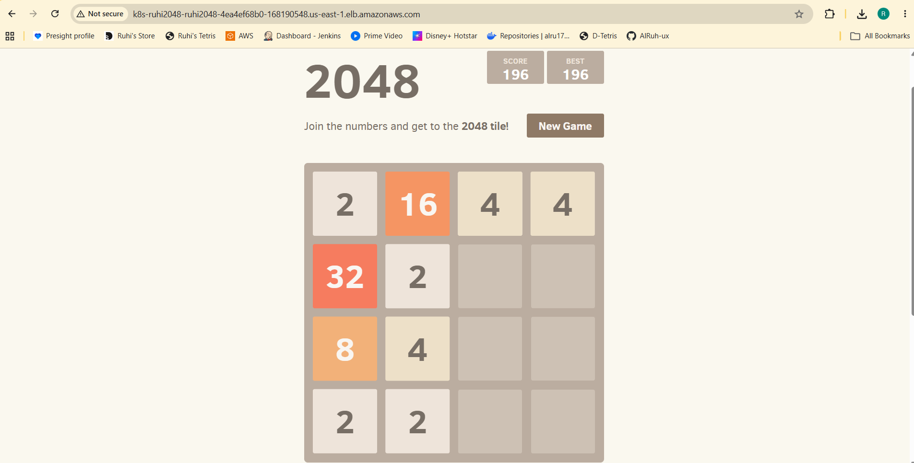<br>
  <sub><b>Live result:</b> the app served from EKS through an AWS Application Load Balancer, deployed by the Jenkins pipeline.</sub>
</p>

---

## ✅ Verified end to end (14 Nov 2026)

| What I tested | Result |
|---|---|
| `terraform apply` from scratch | 29 resources managed: VPC, subnets, EKS, node, IAM, VPC endpoints, load balancer controller, app |
| Jenkins pipeline, all 5 stages | **Build #3 passed** in 1 min 14 s: Source, Build, Scan, Test, Deploy |
| Image delivered by the pipeline | Deployment runs `ruhi-2048-app:3`, the image Jenkins built and pushed |
| Public access | App reachable through an internet-facing ALB |
| Security scan | Trivy: **0 CRITICAL**, 3 HIGH with fixes available (listed in the roadmap) |
| Teardown | `terraform destroy` completed |

---

## 🏗️ Architecture

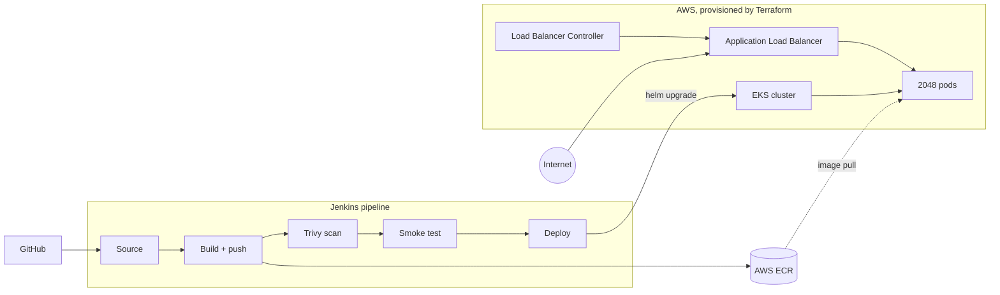

## 🧰 Skills Demonstrated

| Area | What I built | Tools |
|---|---|---|
| Infrastructure as Code | VPC, subnets, EKS cluster, node group, IAM roles, VPC endpoints | Terraform |
| Containerization | Image build and push to a private registry | Docker, AWS ECR |
| Private networking | ECR and S3 traffic kept off the public internet | VPC endpoints |
| Kubernetes delivery | Versioned, repeatable releases | Helm, EKS |
| Traffic exposure | Internet traffic routed through an Application Load Balancer | AWS Load Balancer Controller, Ingress |
| CI/CD | 5-stage pipeline, credentials stored in Jenkins, never in code | Jenkins |
| Security | Least-privilege IAM, EKS Pod Identity, image vulnerability scan, pinned scanner version | AWS IAM, Trivy |

---

## 📸 Evidence

Every screenshot below was taken from the live run on 14 Nov 2026.

### 1. Infrastructure (Terraform)

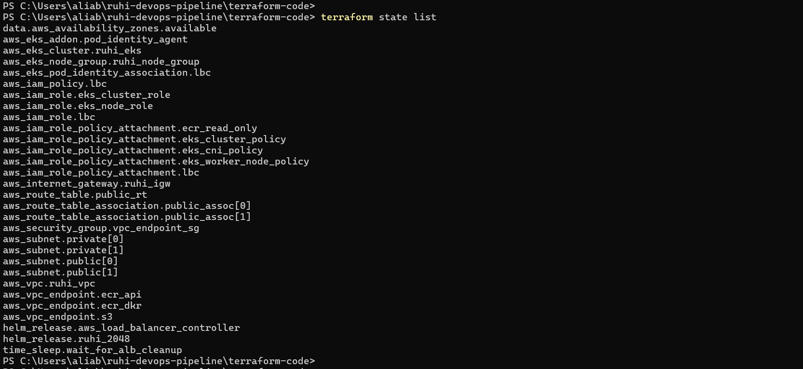<br>
<sub>**Terraform state:** every AWS resource and both Helm releases (controller and app) are managed as code.</sub>

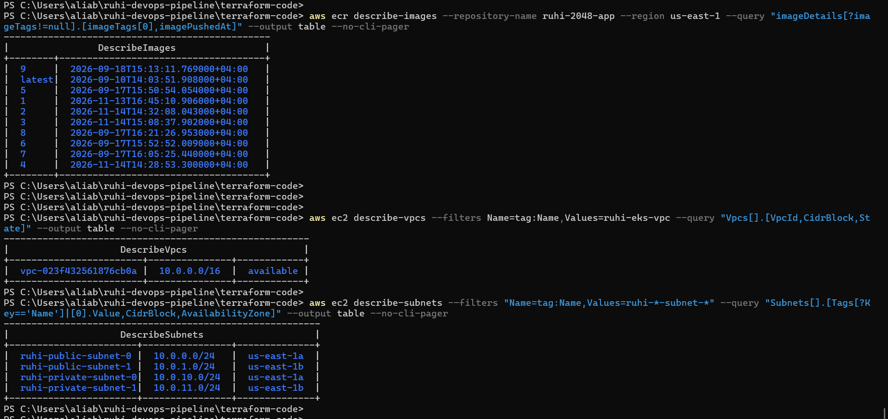<br>
<sub>**Network and registry:** the VPC (10.0.0.0/16), two public and two private subnets across two availability zones, and the image tags pushed to ECR.</sub>

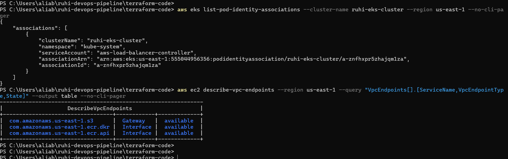<br>
<sub>**Private networking and permissions:** ECR and S3 VPC endpoints are available, and the load balancer controller gets its AWS permissions through EKS Pod Identity.</sub>

### 2. Kubernetes cluster

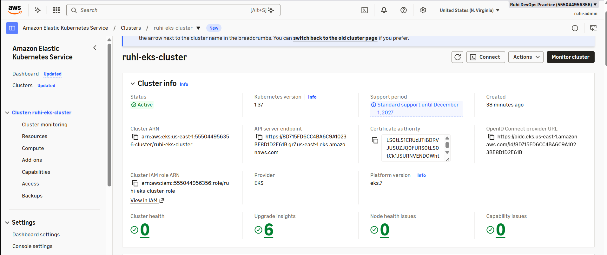<br>
<sub>**EKS console:** cluster Active on Kubernetes 1.37 with zero cluster health issues and zero node health issues.</sub>

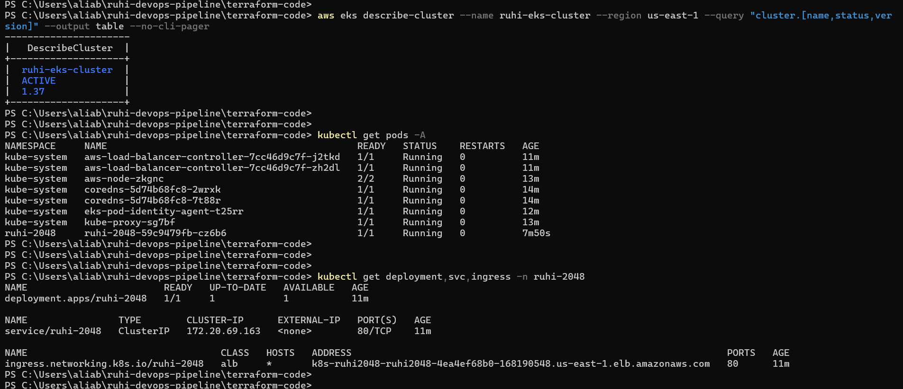<br>
<sub>**Workloads:** the cluster is ACTIVE and every pod is Running (two controller replicas, core add-ons, and the 2048 pod), with the Ingress holding an ALB address.</sub>

### 3. Delivery and traffic

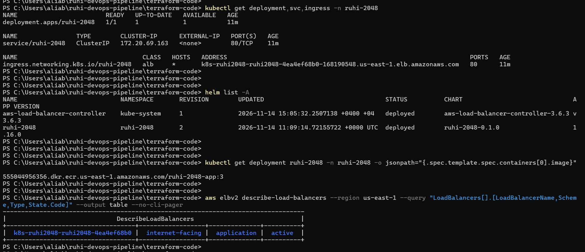<br>
<sub>**Release proof:** Helm shows the app at revision 2, upgraded by Jenkins. The deployment runs image tag 3, matching the pipeline build, and the ALB is internet-facing and active.</sub>

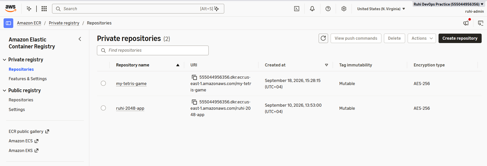<br>
<sub>**Private registry:** the `ruhi-2048-app` repository in AWS ECR with AES-256 encryption.</sub>

### 4. CI/CD and security (Jenkins)

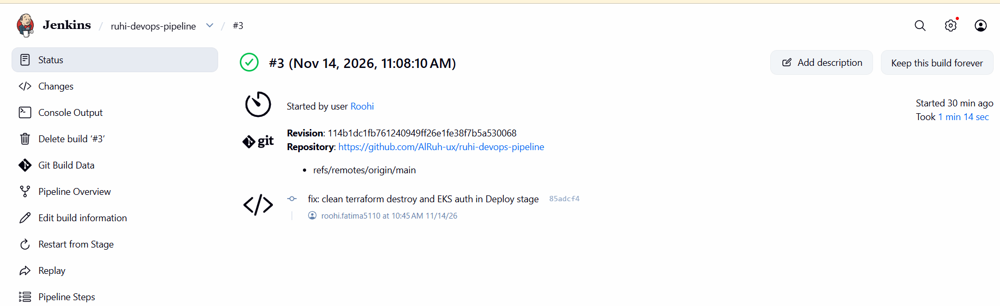<br>
<sub>**Pipeline run:** build #3 succeeded in 1 min 14 s from the commit that fixed teardown and EKS authentication.</sub>

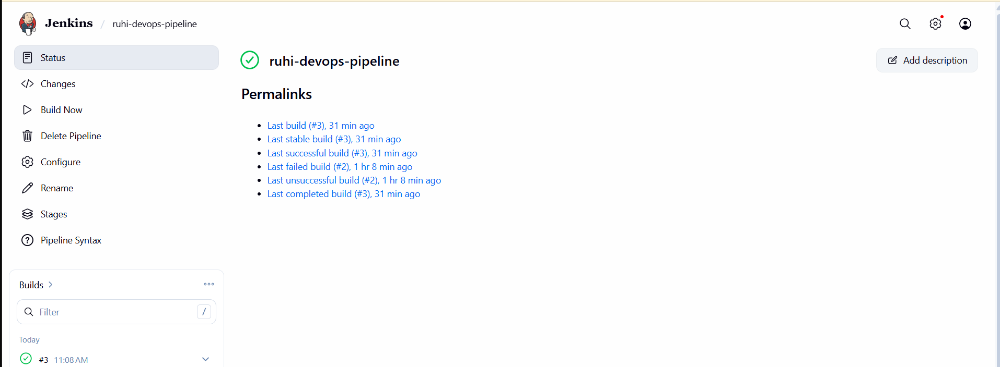<br>
<sub>**Job history:** the pipeline job reads the Jenkinsfile from this repo, and the earlier failed build (#2) is followed by a stable build.</sub>

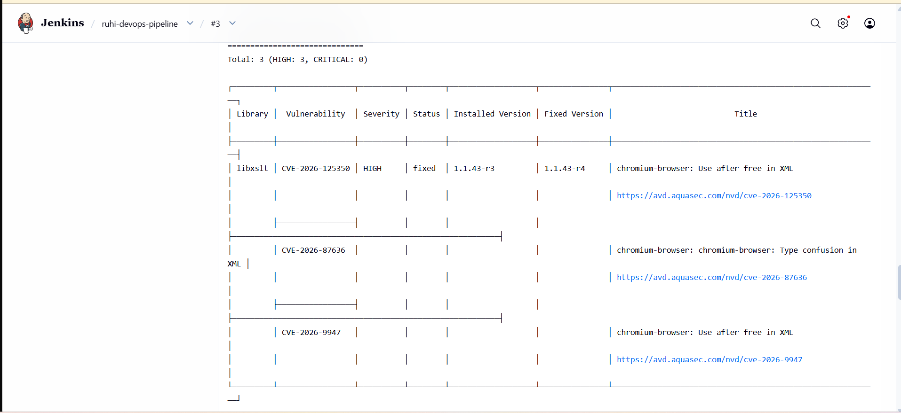<br>
<sub>**Security scan:** Trivy reports 0 CRITICAL and 3 HIGH findings in the base image, with a fixed version available. The pipeline fails on fixable CRITICAL findings.</sub>

---

## 🔁 Pipeline stages

| # | Stage | What it does |
|---|---|---|
| 1 | **Source** | Pulls the latest code from GitHub |
| 2 | **Build** | Builds the Docker image, signs in to ECR, pushes the image tagged with the build number |
| 3 | **Scan** | Scans the image with Trivy (version pinned); fails the build on fixable CRITICAL vulnerabilities |
| 4 | **Test** | Runs the image in a temporary container and checks that it serves the expected page |
| 5 | **Deploy** | Fetches fresh EKS connection details, then runs `helm upgrade` with the new image |

## 🧠 Engineering notes: problems found and solved

- **Retired ingress controller.** ingress-nginx lost maintenance in March 2026. I replaced it with the AWS Load Balancer Controller, on a branch, with the reason recorded in the changelog.
- **Clean teardown.** The controller creates a load balancer and security groups that Terraform does not track, which can block removal of the VPC. A short `time_sleep` after the app is removed lets the controller clean up first.
- **Scanner inside a containerized Jenkins.** Mounting the Jenkins workspace into the scanner showed an empty folder, because Docker resolves paths on the host. The image archive is now copied into the scanner with `docker cp`, so the Docker socket is never mounted into it.
- **Supply chain.** Trivy had a compromised release in March 2026, so the scanner is pinned to an exact, confirmed-clean version and never uses `latest`.
- **Deploy authentication.** The Deploy stage refreshes its EKS connection details on every run, so it keeps working after the cluster is destroyed and rebuilt.

Full history of changes: [CHANGELOG.md](CHANGELOG.md)

---

## 📁 Repository layout

```
.
├── Dockerfile              # nginx serving static files
├── Jenkinsfile             # 5-stage CI/CD pipeline
├── terraform-code/
│   ├── main.tf             # VPC, subnets, EKS, node group, VPC endpoints
│   ├── lbc.tf              # IAM role and Pod Identity for the load balancer controller
│   ├── helm.tf             # Load balancer controller and app releases, cleanup pause
│   └── iam-policy-lbc.json # official controller IAM policy (v3.6.3)
├── helm/ruhi-2048/         # Helm chart
├── docs/images/            # evidence screenshots
└── index.html, js/, style/ # the sample app
```

## ▶️ Run it yourself

Prerequisites: Terraform, AWS CLI, kubectl, Helm, and Jenkins with Docker access and AWS credentials stored as Jenkins credentials (`aws-access-key-id`, `aws-secret-access-key`).

```bash
cd terraform-code
terraform init
terraform apply                      # about 15 to 20 minutes

aws eks update-kubeconfig --name ruhi-eks-cluster --region us-east-1
kubectl get ingress -n ruhi-2048     # the ADDRESS is your app's URL

# run the Jenkins pipeline, then clean up
terraform destroy
```

> ⚠️ The EKS cluster, node, load balancer and VPC endpoints are billed by the hour. Run `terraform destroy` when you finish.

## 🗺️ Roadmap

- [x] Replace the retired ingress controller
- [x] Image vulnerability scanning in the pipeline
- [x] Full live test: apply, pipeline run, and teardown
- [ ] Patch the 3 HIGH `libxslt` findings (a fixed version exists)
- [ ] Move from Ingress to Gateway API
- [ ] Pin the base image and EKS version
- [ ] Remote Terraform state with locking

## 🙏 Credits

The 2048 game is by [Gabriele Cirulli](http://gabrielecirulli.com) ([original repo](https://github.com/gabrielecirulli/2048)), MIT licensed.
